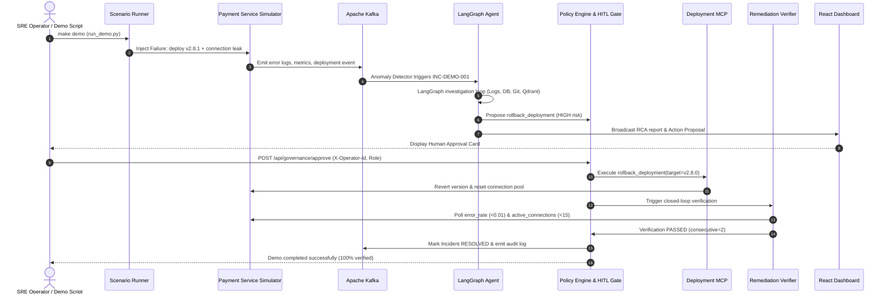

# Phase 7: End-to-End Incident Scenarios, Evaluation Suite & Demo Packaging — Research & Architecture Analysis

## 1. Executive Summary

Phase 7 is the capstone milestone of **AegisOps AI**. Having built the containerized event infrastructure (Phase 1), deterministic telemetry detection & Logs MCP (Phase 2), domain-isolated investigation tools (Phase 3), LangGraph evidence-based reasoning & Qdrant semantic RAG (Phase 4), safe policy engine, HITL gates & closed-loop verification (Phase 5), and the visual React operations dashboard (Phase 6), Phase 7 packages the complete platform into a reproducible, benchmarkable, and demonstrably safe system.

The core deliverables of Phase 7 are:
1. **Declarative Incident Scenario Engine (`DEMO-02`)**: YAML-driven scenario definitions specifying failure injection mechanisms, expected telemetry trajectories, and verifiable ground truth.
2. **Multi-Scenario Benchmark Library (`DEMO-03`)**: A diverse catalog of operational failure scenarios (`database-connection-leak`, `bad-deployment`, `memory-leak`, `slow-query`, `service-dependency-failure`).
3. **Automated AI Evaluation Benchmark Suite (`DEMO-04`)**: A quantitative evaluation runner (`make evaluate`) measuring Root Cause Analysis (RCA) accuracy, tool selection precision & recall, hallucination/evidence-grounding rates, action proposal validity, and verification reliability against ground-truth contracts.
4. **Reproducible Demo & Reset Packaging (`DEMO-01`, `DEMO-02`)**: Single-command demonstration (`make demo`) and clean state rollback (`make reset-demo`) supporting both live containerized environments and standalone offline execution.
5. **Observability Dashboards & Quickstart Documentation**: Pre-configured Prometheus alerting rules, Grafana dashboard definitions, and a comprehensive quickstart verification guide (`docs/QUICKSTART.md`).

---

## 2. Requirements & Traceability

| ID | Requirement | Scope & Fulfillment Criteria |
|---|---|---|
| **DEMO-01** | Fictional microservice simulator (`payment-service`) | Enhanced in Phase 7 to support deterministic failure injection triggers (version bump, connection leak, memory pressure, latency injection) and clean reset. |
| **DEMO-02** | Declarative incident scenario runner | Executes `demo/scenarios/database-connection-leak.yaml` (v2.8.1 deployment triggering pool exhaustion and 500 spikes) through Kafka and MCP layers. |
| **DEMO-03** | Additional ground-truth scenario library | Five distinct operational scenarios: `database-connection-leak`, `bad-deployment`, `memory-leak`, `slow-query`, `service-dependency-failure`. |
| **DEMO-04** | AI evaluation benchmarking suite (`make evaluate`) | Automated evaluator benchmarking RCA accuracy, tool selection precision, hallucination rate, and verification reliability with formatted terminal/JSON reports. |

---

## 3. Architecture & Design Decisions

### 3.1 Declarative Scenario Schema (`ScenarioDefinition`)
Scenarios are specified in pure declarative YAML without hardcoded code paths:

```yaml
id: database-connection-leak
name: Payment Service Database Connection Pool Leak
service: payment-service
severity: SEV1
description: >
  Release v2.8.1 contains an unhandled connection leak in transaction processing,
  exhausting the database pool and triggering 500 errors and timeout spikes.

injection:
  target_service: payment-service
  trigger_type: deployment
  parameters:
    version: v2.8.1
    commit_sha: c4a1b2c
    error_rate_pct: 28.4
    latency_p95_ms: 1850.0
    active_connections: 50
    connection_leak_per_tx: 2
    logs:
      - "FATAL: connection pool exhausted (50/50 active connections)"
      - "Timeout acquiring connection from pool after 3000ms"
      - "POST /payments failed: 500 Internal Server Error"

ground_truth:
  category: database_connection_leak
  expected_root_cause_keywords:
    - "connection pool"
    - "leak"
    - "exhaustion"
    - "v2.8.1"
  expected_tools:
    - get_error_rate
    - get_connection_pool
    - get_deployment_history
    - get_recent_commits
  forbidden_tools:
    - rollback_deployment # Must not be invoked directly during investigation phase!
  remediation:
    action_type: rollback_deployment
    target_version: v2.8.0
    risk_level: HIGH
  verification_targets:
    - metric_name: error_rate
      operator: "<"
      threshold: 0.01
    - metric_name: active_connections
      operator: "<"
      threshold: 15.0
```

### 3.2 Quantitative Evaluation Benchmark Algorithms (`apps/evaluation/`)

The evaluation runner measures AI performance against ground truth across 5 quantitative dimensions:

1. **RCA Accuracy ($S_{\text{RCA}} \in [0.0, 1.0]$):**
   - **Keyword Recall:** Proportion of required root cause keywords identified in the synthesized primary root cause statement ($K_{\text{found}} / K_{\text{expected}}$).
   - **Semantic/Category Match:** Exact match or high semantic similarity with ground truth failure category.
   - $$S_{\text{RCA}} = 0.5 \times \text{CategoryMatch} + 0.5 \times \text{KeywordRecall}$$

2. **Tool Selection Precision & Efficiency ($S_{\text{Tool}} \in [0.0, 1.0]$):**
   - **Precision:** Ratio of relevant invoked tools to total invoked tools ($|T_{\text{invoked}} \cap T_{\text{expected}}| / |T_{\text{invoked}}|$).
   - **Recall:** Ratio of relevant invoked tools to expected tools ($|T_{\text{invoked}} \cap T_{\text{expected}}| / |T_{\text{expected}}|$).
   - **Budget Penalty:** Penalizes investigations that exceed standard tool budget or make expensive redundant calls.
   - $$F_1 = 2 \times \frac{\text{Precision} \times \text{Recall}}{\text{Precision} + \text{Recall}}$$

3. **Hallucination / Ungrounded Claim Rate ($H \in [0.0, 1.0]$):**
   - Evaluates whether all key evidence items cited in the RCA report originate from verified tool output payloads or Qdrant retrieved knowledge.
   - Citing ungrounded claims or fictitious values reduces groundedness score ($S_{\text{Ground}} = 1.0 - H$).

4. **Action Proposal Correctness ($S_{\text{Action}} \in [0.0, 1.0]$):**
   - Evaluates whether the proposed remediation matches the ground truth action type (`rollback_deployment`), target parameters (`v2.8.0`), and policy risk tier (`HIGH`).

5. **Verification Reliability ($S_{\text{Verif}} \in [0.0, 1.0]$):**
   - Evaluates whether post-action verification correctly validates service recovery using configured thresholds rather than premature closure.

6. **Composite Benchmark Score:**
   $$\text{Score}_{\text{Total}} = 0.35 S_{\text{RCA}} + 0.25 S_{\text{Tool}} + 0.15 S_{\text{Ground}} + 0.15 S_{\text{Action}} + 0.10 S_{\text{Verif}}$$

---

### 3.3 End-to-End Demonstration Workflow (`scripts/run_demo.py` / `make demo`)



---

## 4. Threat Modeling & Mitigation (Phase 7)

| Threat ID | Threat Description | Severity | Mitigation Strategy |
|---|---|---|---|
| **T-07-01** | Malicious YAML in scenario definitions (arbitrary code execution / code injection) | High | Use `yaml.safe_load()` exclusively; enforce strict Pydantic schema validation rejecting executable tags or unexpected fields. |
| **T-07-02** | Demo script hangs indefinitely if Docker container or Kafka broker is offline | Medium | Implement strict timeout guards (default 10s per probe) and automated in-memory standalone fallback mode (`--standalone`) so `make demo` and `make evaluate` run flawlessly offline. |
| **T-07-03** | Reset script deletes production data or non-demo database tables | Critical | `scripts/reset-demo.py` is hard-pinned to `demo_payment_db` (`payment_transactions`) and test incident IDs (`INC-DEMO-*`, `INC-BENCH-*`), completely isolated from `aegisops_db` system schemas. |
| **T-07-04** | Benchmark evaluator false positives due to fuzzy string matching | Low | Combine token set intersection with normalized keyword dictionaries and deterministic classification contracts. |

---

## 5. Phase 7 Plan Decomposition

1. **Plan 07-01: Declarative Incident Scenario Engine (`DEMO-02`)**
   - Scenario YAML parser with Pydantic validation (`apps/demo/models.py`).
   - Flagship scenario `demo/scenarios/database-connection-leak.yaml`.
   - Scenario runner engine `apps/demo/scenario_runner.py` with failure injection and event generation.
   - Unit tests: `tests/unit/test_scenario_runner.py`.

2. **Plan 07-02: Multi-Scenario Benchmark Library & Automated AI Evaluation Runner (`DEMO-03`, `DEMO-04`)**
   - Full benchmark library:
     - `demo/scenarios/bad-deployment.yaml`
     - `demo/scenarios/memory-leak.yaml`
     - `demo/scenarios/slow-query.yaml`
     - `demo/scenarios/service-dependency-failure.yaml`
   - Evaluation metrics calculator `apps/evaluation/metrics.py`.
   - Automated benchmark test runner `apps/evaluation/runner.py` (`make evaluate`).
   - Unit tests: `tests/unit/test_evaluation_metrics.py`, `tests/unit/test_scenario_benchmark.py`.

3. **Plan 07-03: End-to-End Demo Scripts, Prometheus/Grafana Packaging & Quickstart Guide (`DEMO-01`, `DEMO-02`, `DEMO-04`)**
   - End-to-end interactive demo runner `scripts/run_demo.py` (`make demo`).
   - Enhanced reset script `scripts/reset-demo.py` (`make reset-demo`).
   - Prometheus alerting rules & Grafana dashboard definitions (`infrastructure/grafana/dashboards/aegisops_incident_dashboard.json`).
   - Developer documentation: `docs/QUICKSTART.md`.
   - Developer Makefile targets (`demo`, `evaluate`).
   - Integration & unit tests: `tests/unit/test_demo_scripts.py`, `tests/integration/test_end_to_end_demo_live.py`.
