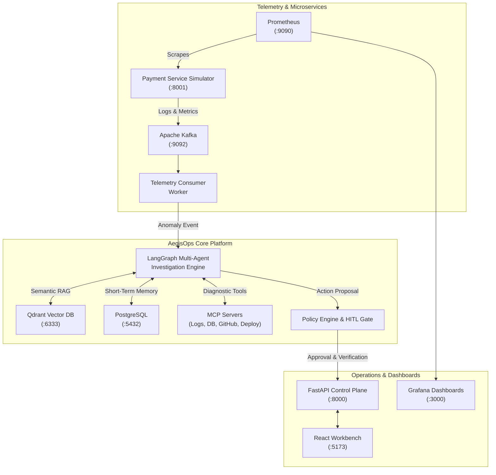

# AegisOps AI — Developer Quickstart Guide

Welcome to **AegisOps AI**, an evidence-driven AI incident intelligence and autonomous operations platform. AegisOps automatically detects operational anomalies, investigates them across Model Context Protocol (MCP) servers and Qdrant semantic memory, computes calibrated root causes, enforces human-in-the-loop (HITL) approval gates, executes remediations, and verifies resolution via closed-loop telemetry polling.

---

## 1. System Architecture



---

## 2. Infrastructure & Port Mapping

| Service | Port | Description | Health Endpoint |
| :--- | :--- | :--- | :--- |
| **React Operations Workbench** | `5173` | Modern Vite/React Operator UI | `http://localhost:5173` |
| **FastAPI Backend API** | `8000` | REST API, SSE streams, Governance | `http://localhost:8000/health` |
| **Payment Service Simulator** | `8001` | Microservice with failure injection | `http://localhost:8001/health` |
| **Prometheus** | `9090` | Telemetry scraping & alerting rules | `http://localhost:9090/-/healthy` |
| **Grafana** | `3000` | Incident & operational dashboards | `http://localhost:3000/api/health` |
| **PostgreSQL** | `5432` | State memory (`aegisops_db`, `demo_payment_db`) | `pg_isready -h localhost -p 5432` |
| **Qdrant** | `6333` | Vector database for incident memory | `http://localhost:6333/healthz` |
| **Apache Kafka** | `9092` | Telemetry ingestion broker | `localhost:9092` |

---

## 3. Prerequisites

- **Docker Desktop** (v24.0+ recommended)
- **Python** 3.12+ (in virtual environment `.venv`)
- **Node.js** 20+ & **npm** 10+
- **Git**

---

## 4. Single-Command Setup & Execution

### Step 1: Clone and Configure Environment
```bash
git clone https://github.com/your-org/AegisOps.git
cd AegisOps
make setup
```
*Creates `.env` from `.env.example` with default developer credentials.*

### Step 2: Spin Up Infrastructure
```bash
make up
```
*Spins up PostgreSQL, Kafka, Qdrant, Prometheus, Grafana, and the Payment Service simulator in the background.*

### Step 3: Prepopulate Semantic Memory
```bash
make seed
```
*Seeds Qdrant vector memory with historical operational incidents, runbooks, and past postmortems.*

### Step 4: Run the End-to-End Flagship Incident Demo
```bash
make demo
```
*Executes the complete 8-step closed loop:*
1. Injects connection leak failure (`database-connection-leak.yaml`) into payment simulator.
2. Detects error rate spike (28.4%) and creates SEV-1 incident.
3. LangGraph investigation queries MCP logs, database connections, and Git diffs.
4. Generates calibrated RCA report (70%+ confidence, pinpointing v2.8.1 leak).
5. Passes through the Policy Approval Gate.
6. Executes controlled deployment rollback to `v2.8.0`.
7. Polls telemetry verification conditions until error rate drops below 1%.
8. Safely resolves the incident and writes an immutable audit record.

### Step 5: Run Multi-Scenario AI Evaluation Benchmark
```bash
make evaluate
```
*Runs the 5-scenario benchmark suite (`database-connection-leak`, `bad-deployment`, `memory-leak`, `slow-query`, `service-dependency-failure`) and prints quantitative accuracy, precision, groundedness, and verification metrics.*

### Step 6: Reset Demo State
```bash
make reset-demo
```
*Resets demo tables and incident history back to pristine status without destroying containers.*

---

## 5. Web UI: Visual Incident Workbench

Access the interactive operator dashboard:
```bash
# In a separate terminal
cd apps/dashboard
npm run dev
```
Open **`http://localhost:5173`** in your browser.

Key Workbench features:
- **Triage Queue**: Live incident feed with severity badges (`SEV-1` through `SEV-4`), active state filters, and service tags.
- **Evidence Explorer**: Interactive tabs for Corroborating Logs, Metric Anomalies, Git Commits, and Qdrant Semantic Similarity matches.
- **Hypothesis Matrix**: Competing operational theories ranked by calibrated confidence score with supporting and refuting evidence badges.
- **Human Approval Modal**: Sensitive and high-risk action proposals (e.g. `rollback_deployment`, `restart_service`) require operator review with audit trail attribution.
- **Audit Trail Viewer**: Searchable, filterable audit log recording every system and operator decision with cryptographic event IDs.

---

## 6. Observability & Dashboards

- **Prometheus** (`http://localhost:9090`): Preconfigured with alerting rules (`PaymentServiceHighErrorRate`, `PaymentServiceDBConnectionPoolExhausted`, `PaymentServiceHighLatency`).
- **Grafana** (`http://localhost:3000`, `admin / admin`): Auto-provisioned dashboard **"AegisOps — Incident Operations & Service Health"** displaying:
  - Error Rate (%) over time
  - P95 Request Latency (ms)
  - Connection Pool Utilization (%)
  - Active Incidents Gauge

---

## 7. Testing & Verification

Run the test suites locally:
```bash
# Run all unit tests (offline mode)
make test-unit

# Run end-to-end integration tests
make test-integration

# Verify demo scripts directly
pytest tests/unit/test_demo_scripts.py -v
```

---

## 8. Troubleshooting FAQ

**Q: `make up` fails with port conflicts.**
- Ensure local services (like standalone PostgreSQL or Prometheus) are stopped on ports `5432` or `9090`.

**Q: Can I run `make demo` or `make evaluate` without Docker running?**
- Yes! The entire investigation and evaluation suite includes autonomous in-memory mocks, allowing full execution in offline/CI environments (`python scripts/run_demo.py --standalone --auto-approve`).

**Q: How do I completely wipe all persistent Docker volumes?**
```bash
make clean
```
